# 🧬 ClawBio-Pipeline: Production Multi-Omics Workflow Orchestrator

[](https://www.python.org/)
[](https://www.docker.com/)
[](https://fastapi.tiangolo.com)
[](https://aws.amazon.com/s3/)
[](https://www.ncbi.nlm.nih.gov/clinvar/)
[](https://biopython.org/)
[](https://plotly.com/)
[](https://github.com/Textualize/rich)
[](https://opensource.org/licenses/MIT)

**ClawBio-Pipeline** is an elite, industry-grade workflow orchestrator engineered for high-throughput computational biology and clinical genomics (WGS, RNA-Seq, ChIP-Seq). It bridges the gap between rapid local prototyping and production cloud-scale genomics by offering:
- **Dual Execution Modes:** Seamless toggling between **Rapid Simulation** and **Real Execution Mode** (invoking FastQC, BWA MEM, SAMtools, and Biopython).
- **Multi-Sample Parallel Concurrency:** ThreadPool execution with live per-sample CPU and peak RAM resource profiling (`psutil`).
- **Downstream Variant Calling & VCF Generation:** Standard VCF v4.2 emission with ClinVar significance and ACMG classification codes.
- **2026 AI Clinical Oncology Agent:** Automated therapeutic matchmaker linking pathogenic mutations (*TP53*, *BRCA1/2*, *PIK3CA*, *EGFR*) to FDA-approved targeted drugs, drug resistance profiles, and active clinical trials (100% free with built-in offline clinical intelligence).
- **Automated Smart Insight Engine:** Clinical heuristic flagging for coverage drops, GC bias, and adapter contamination with biological remediation advice.
- **REST API & Cloud Ready:** Asynchronous FastAPI backend with AWS S3 / MinIO support and Docker containerization.

---

## 🏗️ System Architecture

```mermaid
flowchart TD
    subgraph INGESTION["1. Ingestion & Cloud Storage Layer"]
        A1["Local FASTQ Files<br/>(data/raw/*.fastq)"]
        A2["Cloud S3 / MinIO Buckets<br/>(s3://bucket/key)"]
        A3["FastAPI Multipart<br/>(/api/pipeline/upload-and-run)"]
    end

    subgraph ORCHESTRATION["2. Orchestration & Resource Profiling"]
        B1["Config Parser & YAML Validator<br/>(Biopython SeqIO Check)"]
        B2["Multi-Sample Parallel ThreadPool<br/>(concurrent.futures)"]
        B3["Per-Sample Resource Tracker<br/>(psutil: CPU, RAM, Latency)"]
    end

    subgraph EXECUTION["3. Dual-Engine Alignment & QC Layer"]
        C1{"Execution Mode Toggle"}
        C2["Real Tool Wrapper Engine<br/>• FastQC CLI / Native SeqIO<br/>• BWA MEM Alignment<br/>• SAMtools View, Sort, Index, Flagstat"]
        C3["Bioinformatics Simulator<br/>• FastQC Statistics Simulator<br/>• BWA / BAM Alignment Simulator"]
    end

    subgraph VARIANTS["4. Variant Calling & AI Clinical Oncology Agent"]
        V1["Variant Calling & VCF v4.2 Emission<br/>(SNVs, InDels, Allele Frequency, Depth)"]
        V2["ClinVar & ACMG Pathogenicity Annotation<br/>(PVS1, PS1, PM2 Evidence Codes)"]
        V3["2026 AI Clinical Oncology Agent<br/>• Targeted Therapies (PARP, TKIs)<br/>• Drug Resistance Biomarkers<br/>• Active Clinical Trial Matches (NCT)"]
    end

    subgraph INSIGHTS["5. Smart Insight & Anomaly Engine"]
        D1["Rule Evaluation & Threshold Check<br/>• Mapping Rate (&lt; 95%)<br/>• GC Deviation (&gt; 10% vs Ref)<br/>• Phred Score (&lt; Q30)<br/>• Adapter Contamination Flag<br/>• Duplication Rate (&gt; 8%)"]
        D2["Biological Remediation Insight Engine<br/>(PCR bias, adapter clipping, flowcell drift)"]
    end

    subgraph DELIVERY["6. Multi-Channel Presentation & Delivery"]
        E1["Plotly + Jinja2 HTML Report<br/>(Therapeutic Cards, Variant Tables, Anomaly Alerts)"]
        E2["Rich CLI Dashboard<br/>(Live Progress & Formatted Alerts)"]
        E3["Standard VCF Outputs<br/>(results/variants/*.vcf)"]
        E4["FastAPI REST Endpoints<br/>(Async Jobs & Report Downloads)"]
        E5["Cloud S3 Sync<br/>(Automated Report Upload)"]
    end

    INGESTION --> ORCHESTRATION
    B1 --> B2
    B2 --> B3
    B3 --> C1
    C1 -- Real Mode --> C2
    C1 -- Simulation Mode --> C3
    C2 --> VARIANTS
    C3 --> VARIANTS
    VARIANTS --> INSIGHTS
    INSIGHTS --> DELIVERY
```



---

## 🚀 Key Modules & Capabilities

### 1. Downstream Variant Calling & ClinVar / ACMG Annotation
- **Standard VCF v4.2 Generation:** Emits compliant VCF files into `results/variants/{sample_id}.vcf` recording variant alleles, genotype (`GT`), read depth (`DP`), allele frequency (`AF`), and quality scores (`QUAL`).
- **Clinical Annotation Engine:** Annotates mutations with:
  - HGVS cDNA and Protein notation (e.g. `c.818G>A (p.Arg273His)`, `c.5266dupC (p.Gln1756Profs*74)`).
  - ClinVar Pathogenicity Status (`Pathogenic`, `Likely Pathogenic`, `Benign`, `VUS`).
  - ACMG Evidence Tags (`PVS1`, `PS1`, `PM2`, `PP3`).

### 2. 2026 AI Clinical Oncology & Actionable Therapeutics Agent
- **Targeted Drug Matching:** Aligns pathogenic variants to FDA-approved therapies and NCCN guidelines:
  - *BRCA1 / BRCA2* ➔ PARP Inhibitors (*Olaparib*, *Niraparib*, *Rucaparib*) [Level 1A].
  - *PIK3CA* E545K ➔ PI3Kα Inhibitor (*Alpelisib*) [Level 1B].
  - *TP53* R273H ➔ Cell-cycle checkpoint vulnerabilities & Platinum chemotherapy [Level 2].
  - *EGFR* L858R ➔ 3rd-Gen TKIs (*Osimertinib*) [Level 1A].
- **Drug Resistance Profiling:** Flags secondary resistance pathways and target bypass signaling.
- **Clinical Trial Matching:** Identifies active Phase II/III clinical trial identifiers (NCT numbers).
- **Zero Cost:** Works 100% offline with zero external API fees via the built-in clinical oncology knowledge engine (or optionally connects to Gemini/OpenAI if an API key is provided).

### 3. Real Tool Wrapper Integration (Simulation vs. Real Mode)
- **Toggle Modes:** Run `--mode simulation` for rapid demos or `--mode real` to invoke `fastqc`, `bwa mem`, and `samtools`.
- **Biopython Fallback:** In environments without local binaries, executes exact base-level calculations using `Bio.SeqIO` (exact GC content, Phred quality scoring, adapter sequence screening).

### 4. Multi-Sample Parallel Concurrency & Resource Tracking
- **Parallel Workers:** Uses `concurrent.futures.ThreadPoolExecutor` with `--workers N`.
- **Resource Monitoring:** Measures runtime (s), CPU utilization (%), and peak RAM consumption (MB) using `psutil`.

### 5. Automated Biological Anomaly Engine
- **Heuristic Quality Checks:** Flags mapping rate drops ($<95\%$), GC deviations ($>10\%$), base quality degradation ($<Q30$), and adapter contamination.
- **High-Visibility Alerts:** Flagged samples are highlighted in crimson/amber in the HTML dashboard and terminal.

### 6. Cloud Storage & REST API (FastAPI + S3/MinIO)
- **FastAPI Endpoints:** Asynchronous pipeline triggering, multipart FASTQ uploads, job polling, and direct report downloads.
- **S3 / MinIO Integration:** Direct support for `s3://` URIs and cloud report synchronization.

---

## 📁 Repository Structure

```
clawbio-pipeline/
├── Dockerfile                      # Production Docker container definition
├── docker-compose.yml              # Multi-container orchestration (CLI + API)
├── environment.yml                 # Conda / Mamba / Pixi reproducible environment
├── requirements.txt                # Python package dependencies
├── config.yaml                     # Pipeline configuration & clinical thresholds
├── main.py                         # Rich CLI entrypoint & orchestrator
├── generate_sample_data.py         # Synthetic benchmark FASTQ generator
├── data/
│   └── raw/
│       ├── Normal_Control_R1.fastq
│       ├── Tumor_Biopsy_R1.fastq
│       └── Artifact_Sample_R1.fastq
├── src/
│   ├── __init__.py
│   ├── parser.py                   # PyYAML loader & Biopython validator
│   ├── orchestrator.py             # Parallel multi-sample execution engine
│   ├── tool_wrappers.py            # FastQC, BWA, SAMtools & Biopython QC
│   ├── variant_engine.py           # Variant caller, VCF writer & ClinVar annotator
│   ├── clinical_agent.py           # 2026 AI Clinical Oncology & Therapeutics Agent
│   ├── anomaly_engine.py           # Biological variant & sequencing anomaly engine
│   ├── resource_tracker.py         # psutil CPU, RAM & runtime monitor
│   ├── cloud_storage.py            # AWS S3 / MinIO client
│   ├── api.py                      # FastAPI REST API & background task runner
│   └── report.py                   # Plotly + Jinja2 clinical HTML dashboard
└── tests/
    ├── test_cli.py                 # CLI integration tests
    ├── test_parser.py              # Configuration & SeqIO tests
    ├── test_tool_wrappers.py       # Tool wrappers & flagstat parsing tests
    ├── test_variant_engine.py      # Variant calling & VCF emission tests
    ├── test_clinical_agent.py      # AI Clinical oncology matching tests
    ├── test_anomaly_engine.py      # Biological anomaly tests
    ├── test_resource_tracker.py    # Resource profiling tests
    ├── test_cloud_storage.py       # AWS S3 / MinIO client tests
    ├── test_api.py                 # FastAPI endpoints & async tests
    ├── test_generator.py           # Synthetic dataset generator tests
    └── test_report.py              # Interactive report generation tests
```

---

## 🛠️ Quickstart

### 1. Installation

```bash
git clone https://github.com/Febiri/ClawBio-Pipeline.git
cd ClawBio-Pipeline

# Setup virtual environment
python -m venv venv

# Windows
.\venv\Scripts\Activate.ps1
# Linux / macOS
source venv/bin/activate

# Install dependencies
pip install -r requirements.txt
```

### 2. Instant Sample Data Generation

```bash
python main.py generate-samples --reads 150
```

### 3. Run Pipeline via Rich CLI

#### Real Execution Mode (QC, Alignment, VCF Calling & Clinical Agent):
```bash
python main.py run-pipeline --mode real --workers 3
```

#### Rapid Simulation Mode:
```bash
python main.py run-pipeline --mode simulation
```

#### Validate Input Sequence Files:
```bash
python main.py validate --config config.yaml
```

### 4. Run with Docker / Docker Compose

Run the pipeline instantly in an isolated container without installing Python dependencies locally:

```bash
# Build and run CLI pipeline
docker-compose up pipeline

# Run FastAPI REST Service on port 8000
docker-compose up api
```

### 5. View the Interactive Report & VCF Files

Open `results/execution_report.html` in your browser:

```bash
# Windows
start results/execution_report.html

# macOS
open results/execution_report.html

# Linux
xdg-open results/execution_report.html
```

Inspect generated VCF files:
```bash
cat results/variants/Tumor_Biopsy_R1.vcf
```

---

## 🌐 FastAPI REST API & Cloud Storage

### Start the REST API Server

```bash
python main.py serve --host 127.0.0.1 --port 8000
```
Interactive OpenAPI documentation is available at `http://127.0.0.1:8000/docs`.

### API Usage Examples

#### 1. Trigger Async Pipeline with S3 or Local Files
```bash
curl -X POST "http://127.0.0.1:8000/api/pipeline/run-async" \
     -H "Content-Type: application/json" \
     -d '{
       "project_name": "Clinical Oncology Cohort",
       "execution_mode": "real",
       "max_workers": 4,
       "samples": [
         {"sample_id": "Tumor_Biopsy", "raw_fastq": "data/raw/Tumor_Biopsy_R1.fastq"},
         {"sample_id": "Normal_Control", "raw_fastq": "data/raw/Normal_Control_R1.fastq"}
       ]
     }'
```

#### 2. Upload FASTQ File Directly and Run
```bash
curl -X POST "http://127.0.0.1:8000/api/pipeline/upload-and-run" \
     -F "file=@data/raw/Artifact_Sample_R1.fastq" \
     -F "sample_id=Clinical_Sample_01" \
     -F "mode=real"
```

#### 3. Check Job Status & Clinical Findings
```bash
curl -X GET "http://127.0.0.1:8000/api/jobs/<YOUR_JOB_ID>"
```

#### 4. Download / View Interactive HTML Report
```bash
curl -X GET "http://127.0.0.1:8000/api/jobs/<YOUR_JOB_ID>/report" \
     --output results/cloud_report.html
```

---

## 🧪 Comprehensive Test Suite

The project includes **46 automated unit and integration tests** covering all components:

```bash
pytest -v
```

```
collected 46 items

tests/test_anomaly_engine.py::test_anomaly_detector_optimal PASSED
tests/test_anomaly_engine.py::test_anomaly_detector_low_mapping PASSED
tests/test_anomaly_engine.py::test_anomaly_detector_gc_bias PASSED
tests/test_anomaly_engine.py::test_anomaly_detector_low_quality_and_adapter PASSED
tests/test_api.py::test_api_health PASSED
tests/test_api.py::test_api_run_async_and_poll PASSED
tests/test_api.py::test_api_upload_and_run PASSED
tests/test_api.py::test_api_job_not_found PASSED
tests/test_bio_tasks_simulator.py::test_simulate_fastqc PASSED
tests/test_bio_tasks_simulator.py::test_simulate_alignment_summary PASSED
tests/test_cli.py::test_cli_help PASSED
tests/test_cli.py::test_cli_run_pipeline_simulation PASSED
tests/test_cli.py::test_cli_run_pipeline_real PASSED
tests/test_cli.py::test_cli_validate PASSED
tests/test_cli.py::test_cli_generate_samples PASSED
tests/test_clinical_agent.py::test_clinical_interpretation_pathogenic PASSED
tests/test_clinical_agent.py::test_clinical_interpretation_benign_only PASSED
tests/test_cloud_storage.py::test_is_s3_uri PASSED
tests/test_cloud_storage.py::test_parse_s3_uri PASSED
tests/test_cloud_storage.py::test_download_s3_file PASSED
tests/test_cloud_storage.py::test_upload_s3_file PASSED
tests/test_generator.py::test_generate_sequence PASSED
tests/test_generator.py::test_generate_phred_string PASSED
tests/test_generator.py::test_write_synthetic_fastq PASSED
tests/test_generator.py::test_generate_dataset PASSED
tests/test_parser.py::test_load_config_valid PASSED
tests/test_parser.py::test_load_config_missing PASSED
tests/test_parser.py::test_get_sample_ids PASSED
tests/test_parser.py::test_get_sample_ids_empty PASSED
tests/test_parser.py::test_validate_fastq_valid PASSED
tests/test_parser.py::test_validate_fastq_invalid PASSED
tests/test_parser.py::test_validate_fastq_nonexistent PASSED
tests/test_parser.py::test_validate_samples PASSED
tests/test_report.py::test_generate_html_report_single_sample PASSED
tests/test_report.py::test_generate_html_report_multi_sample PASSED
tests/test_resource_tracker.py::test_resource_tracker_context PASSED
tests/test_resource_tracker.py::test_resource_tracker_start_stop PASSED
tests/test_tool_wrappers.py::test_is_tool_installed PASSED
tests/test_tool_wrappers.py::test_parse_samtools_flagstat PASSED
tests/test_tool_wrappers.py::test_native_biopython_qc PASSED
tests/test_tool_wrappers.py::test_native_biopython_alignment PASSED
tests/test_tool_wrappers.py::test_execute_sample_wrapper_simulation PASSED
tests/test_tool_wrappers.py::test_execute_sample_wrapper_real PASSED
tests/test_variant_engine.py::test_call_and_annotate_tumor_variants PASSED
tests/test_variant_engine.py::test_call_and_annotate_normal_variants PASSED
tests/test_variant_engine.py::test_write_vcf_file PASSED

======================== 46 passed in 8.41s ========================
```

---
